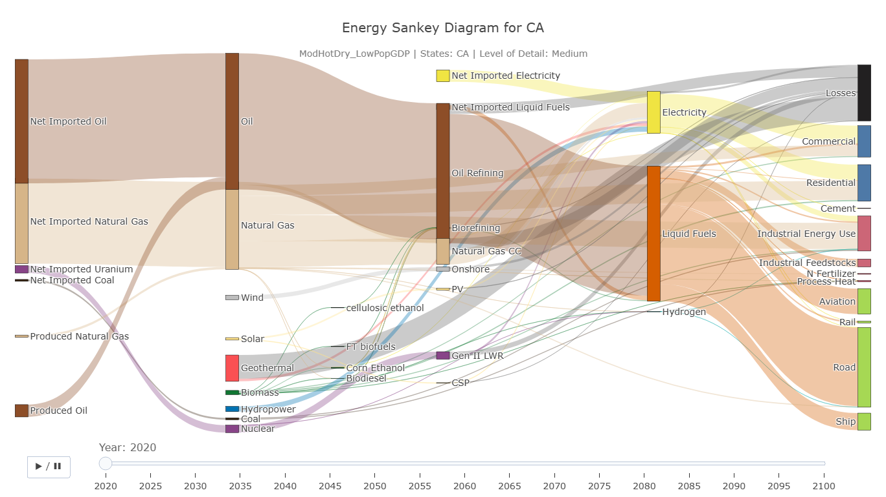
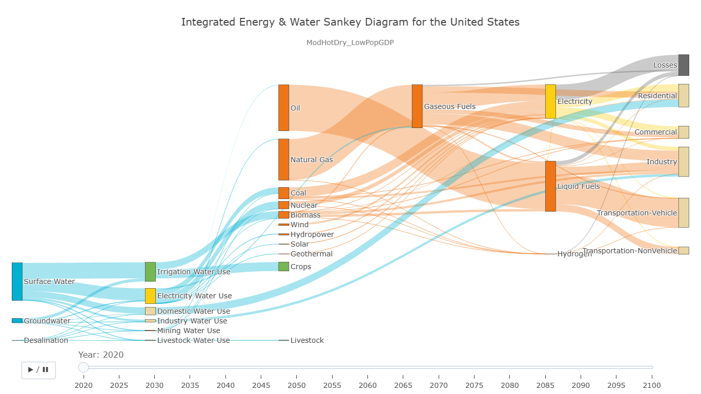
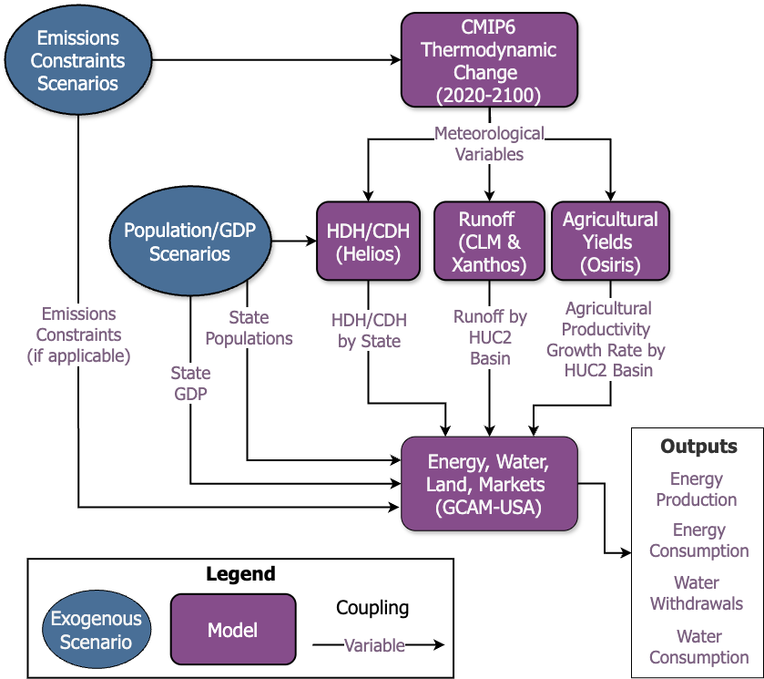

# VIEWS

**V**isualizations for **I**nterdependent **E**nergy-**W**ater **S**ecurity

`VIEWS` is an open-source, interactive dashboard for visualizing energy and water flows and their cross-sectoral interdependencies across US states. It combines data processed in R with a Svelte-based web application to explore [GCAM-USA](https://github.com/JGCRI/gcam-core) simulation results through Sankey diagrams.

## Purpose

Energy and water systems are interconnected. Water supports energy production, and energy supports water supply and use. These relationships create opportunities and vulnerabilities across sectors and regions, particularly as population, economic activity, and technologies change. `VIEWS` was created to:

* Visualize energy and water flows through resource supply, transformation, and use sectors.
* Explore cross-sectoral dependencies through integrated energy and water diagrams.
* Compare state-level energy flows across regions and levels of detail.
* Examine how resource flows change over time under alternative socioeconomic and future weather scenarios.
* Provide downloadable data to support further analysis.



The dashboard provides three diagram types: **Energy**, **Water**, and combined **Energy & Water**. Users can select scenarios and units, animate changes over time, and download the data behind their selections. The Energy diagram also supports selecting one or more US states and choosing Low, Medium, or High detail.

<!-- IMAGE PLACEHOLDER: Add sankey_dashboard/static/energy-water.png -->



## Installation

To run the dashboard locally, install [Node.js](https://nodejs.org/) 18 or later with npm, then run the following from the repository root:

```bash
cd sankey_dashboard
npm install
npm run dev
```

Open the local URL printed in the terminal, usually [http://localhost:5173](http://localhost:5173).

## Quickstarter

With the dashboard running:

1. Choose **Energy**, **Water**, or **Energy & Water**.
2. Select a population/GDP growth and future weather scenario.
3. For the Energy diagram, select one or more US states and a level of detail.
4. Choose units and a color palette.
5. Move the year slider or press play to explore changes over time.
6. Download the current selection as a CSV for further analysis.

Energy flows can be displayed in exajoules, quads, or terawatt-hours. Water flows can be displayed in cubic kilometers, billion gallons, or million acre-feet.

## Methodology

### Scenario Design

| GCAM-USA Scenario names | Emissions constraints | Degree of hotter and drier weather\* | Population and economic growth |
| --- | --- | --- | --- |
| ModHotDry_LowPopGDP | Moderate | Moderately | Low |
| ModHotDry_HighPopGDP | Moderate | Moderately | High |
| SevHotDry_LowPopGDP | None | Severely | Low |
| SevHotDry_HighPopGDP | None | Severely | High |

\*This dashboard shows IM3 GCAM-USA results driven by 21<sup>st</sup> century projections of future hourly meteorology derived from monthly thermodynamic signals from CMIP6 projections. In addition to distinguishing between moderately versus severely hotter and drier futures (largely driven by emissions scenario assumptions), the projections account for structural model uncertainties that cause the projections to be relatively cooler or hotter for a given emissions trajectory. This produces a total of four 21<sup>st</sup> century projections. In this dashboard, however, for tractability purposes, we present GCAM-USA results only from the relatively cooler projection models.

For additional information on the meteorological projections, please refer to: Jones, A.D., Rastogi, D., Vahmani, P., Stansfield, A., Reed, K.A., Thurber, T., Ullrich, P.A., & Rice, J.S. Continental United States climate projections based on thermodynamic modification of historical weather. *Sci Data* 10, 664 (2023). [https://doi.org/10.1038/s41597-023-02485-5](https://doi.org/10.1038/s41597-023-02485-5)

### GCAM-USA IM3 Experiment



For more information on IM3, please see [https://im3.pnnl.gov](https://im3.pnnl.gov)

### Global Change Analysis Model - USA

The Global Change Analysis Model (GCAM) Wiki (version 5.3): [jgcri.github.io/gcam-doc/v5.3/toc.html](https://jgcri.github.io/gcam-doc/v5.3/toc.html)

GCAM Modeling Outputs Underlying Visualizations: Zhao, M., Ahsan, H., Binsted, M., Patel, P., Rice, J. S., Snyder, A., Vernon, C. R., & Wild, T. B. (2024). GCAM-USA: IM3 Phase 2 Official Simulations (Version v1) [Data set]. MSD-LIVE Data Repository. doi:[10.57931/2428940](https://doi.org/10.57931/2428940)

| Global Change Analysis Model (GCAM) | GCAM-USA Spatial Resolutions |
| --- | --- |
|  |  |

## Acknowledgments

This work was developed by Pacific Northwest National Laboratory as part of the [Integrated Water Power Resilience Project](https://www.pnnl.gov/projects/integrated-water-power-resilience-project) with funding by the [U.S. Department of Energy Hydropower and Hydrokinetic Office (H2O)](https://www.energy.gov/cmei/water/hydropower-and-hydrokinetic-office) Energy-Water Resilience Program and the [U.S. Department of Energy Office of Science](https://www.energy.gov/science/office-science) as part of research in MultiSector Dynamics, Earth and Environmental Systems Modeling Program.
